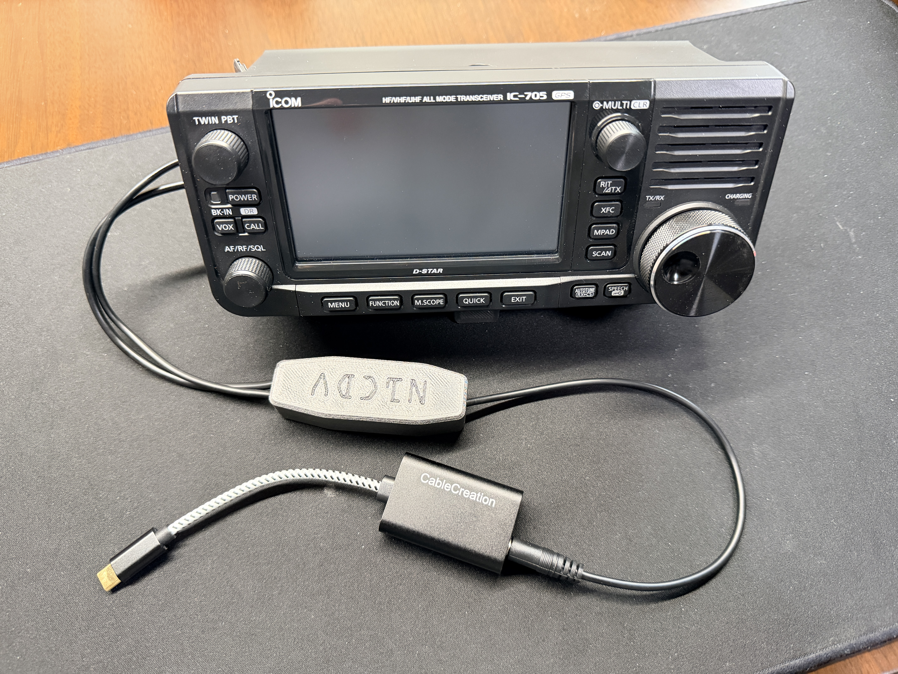
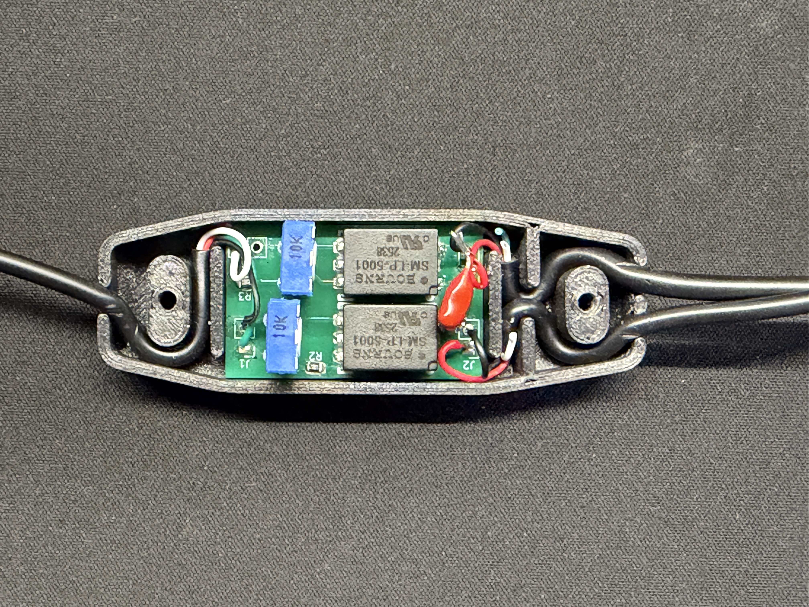

# IC-705 Audio Interface

This project was done as a learning exercise for me, and a way to have some fun. I wanted to use my IC-705 with just an iPhone to drive digital mode communications, but limitations of both the radio and the phone meant things like straight USB or Bluetooth wouldn't work. There is a solution path with WiFi-based software, but I didn't want to be locked into a single app (even though I use it on my iPad and find it very good).
The result is a minimal solution that is ideal for remote or portable operation (such as POTA or SOTA) with iOS.

All said and done, I have got this working with iFTx to successfully complete QSOs!

Digirig? Yes, that could have been the solution. Again, the hobby for me is about building and learning. I'm also not sure if it will work properly for driving the MIC input to the IC-705 at the right level when paired with an iOS device.

The basis for the design is an [example circuit](images/Icom_example_interface.JPG) that Icom provides in their advanced manual. Addition of a capacitor on the MIC line is required to create a high resistance path to not activate PTT (the IC-705 uses the same pin for both MIC input and PTT).

In the end, this device is an audio level shifter with isolation. It can be used with any device (PC, tablet, phone) that has an analog audio input (microphone or line in) and an analog audio output. Just tune the trim pots to hit the levels you need.

Have a PC? Just use the built-in USB functionality or Wi-Fi interface. This adds no value, whatsoever, over those options. This is really for phones using inexpensive (or free) apps that require VOX activation.

## Design Notes

Design files (PCB, schematic) can be found in the [KiCad directory](KiCad/).

A [screenshot of the schematic](images/ic-705_audio_interface_schematic.JPG) is also available for quick reference.

Icom doesn't seem to publish the MIC input electrical specifications. Through empirical testing, it seems the maximum IC-705 MIC input level before clipping is 50 mVpp.

The methodology was:
1. Set the iPhone volume to max
1. Set the FT8 software to call CQ at ~3000 Hz offset
1. Activate the voice recorder (VOICE TX -> REC/SET -> REC -> T1 -> record)
1. Set MIC gain to 50% (default level)
1. Adjust the trim pot until the meter hits 100%

I've observed about 0.7 dB of rolloff at 200 Hz vs 3000 Hz (could be the soundcard, could be the interface, I haven't looked harder), so that's why using the upper part of the sideband is good for setting max power level.

I landed on AF GAIN = 30 as that seems to be the highest value before output clipping occurs.

## Assembly Notes

This is a straight forward board to assemble. The IC-705 side uses a 3.5mm TRS for the speaker connector and a 2.5mm TRRS for the mic connector. I used a 3.5mm TRRS to connect to the phone side with the jumper soldered, but you can use two cables instead.

For PCB assembly, I recommend doing the SMT parts first, then the trim pots, then the cables.

The output capacitor that goes inline with the IC-705 mic input was left off the PCB to keep the footprint as small as possible. Put one leg into the PCB and the other towards the cable.

[DigiKey BOM](https://www.digikey.com/en/mylists/list/Q781V9DVDD) @ $7

[2.5mm TRRS cable](https://a.co/d/0cmaGAqM) @ $9 ($1.50/ea)

[3.5mm TRRS cable](https://a.co/d/0evUUoQW) @ $8 ($2/ea)

[3.5mm TRS cable](https://a.co/d/0eWTbZUC) @ $8 ($4/ea)

[USB audio interface](https://a.co/d/0cbzTN2W) (others will work, too)

[3D printable case files](https://www.printables.com/model/1877246-ic-705-audio-interface-box)

Below is an image of the cable routing and capacitor placement. It is done this way for strain relief. 

After assembly, tune the trim pots so that the MIC input for the IC-705 reaches 50 mVpp while calling CQ.

I set the device side mic to 45 mVpp as this was saturation for my device. To tune it yourself, use the record function to save a CQ TX to the microSD card, then play it back with AF GAIN = 30. You should get full scale output without clipping and use that to tune the trim pot. Pair with any free app or built-in program that shows the mic level input on your device.

At the time of writing, the total component cost was $14.50 and the PCB was $1.20/ea. I have 8 extra PCBs so create an issue here to contact me about getting one. Send me a self-addressed stamped envelope and I'll send you one for free.

## IC-705 and iOS Settings

IC-705:
- MIC gain = 50% (default)
- COMP = 5 (default)
- VOX gain = 50% (default)
- ANTI VOX = 50% (default)
- Delay = 0.0s
- Voice delay = OFF (default)
- VOX = on
- AF GAIN = 30
- Frequency = as appropriate (14.074, etc) 
- Mode = USB (do NOT use USB-D, VOX doesn't work)

iOS:
- Put the phone to silent mode. ALL sounds will make its way to the radio, so silent mode enabled to prevent your TX from getting in trouble when you get a notification.
- Turn the volume all the way up (which should have been where it was when you tuned the trim pots).
